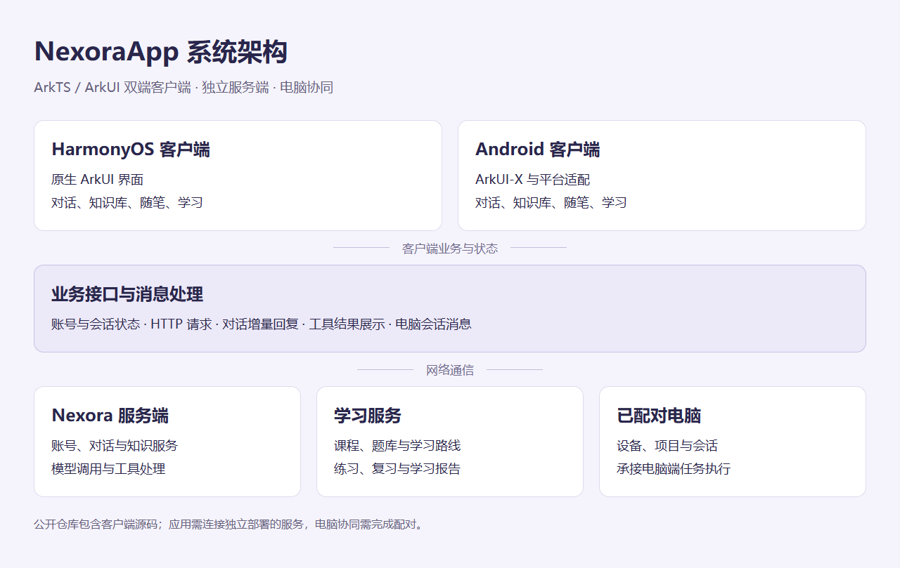

# NexoraApp

NexoraApp 是面向 HarmonyOS 与 Android 的智能助手，将 AI 对话、知识管理、随笔记录和学习工作区放在同一个移动应用中。用户可以在手机上提问、整理资料、记录想法，也可以继续学习课程或查看已配对电脑的项目会话。

## 主要功能

### AI 对话

应用支持会话管理和模型选择。回复以增量方式显示，用户可以边生成边阅读，并查看思考内容和工具调用结果。聊天界面围绕移动端操作组织输入、消息和侧栏，让连续提问和切换会话更方便。

### 知识与随笔

用户可以创建、编辑知识库，为资料整理和后续问答建立入口。随笔用于记录临时想法，支持搜索、轻量 Markdown 和自动保存，减少在不同工具之间来回切换。

### 学习工作区

学习功能使用原生 ArkUI 界面，包含首页、课程、题库、资源与个人页面。用户可以查看课程和章节，阅读学习内容，沿学习路线推进，并进行练习和查看学习报告。鸿蒙端还包含学习助手入口，将学习问答、复习和报告集中呈现。

### 电脑协同

应用可展示已配对的电脑、项目和会话，并向电脑端会话发送消息。用户离开电脑后，也能通过手机继续查看和参与项目任务。此功能需要电脑端在线并完成配对。

## 双端实现与架构

鸿蒙客户端使用 ArkTS、ArkUI 开发；Android 客户端通过 ArkUI-X 运行同类应用界面，并保留对应的平台适配。两个客户端连接独立部署的 Nexora 服务端，应用侧负责界面、交互状态和业务接口调用，服务端提供账号、对话、知识及学习等服务，电脑协同还需要已配对的电脑。

## 构建和使用

源码仓库的 `NexoraApp/` 是 HarmonyOS 工程，`NexoraApp_Android/` 是 Android / ArkUI-X 工程。分别在 DevEco Studio 中打开对应目录，安装与工程匹配的 SDK 和项目依赖；Android 端还需准备 ArkUI-X 与 Android 构建环境。SDK 路径和应用签名在本机配置。

安装应用后，连接可用的 Nexora 服务并登录，即可使用聊天和相关工作区。电脑协同需另行完成电脑配对。本仓库提供两端客户端源码，服务端独立部署。作品以原生移动应用形式运行，展览馆不提供浏览器内直接运行的体验页。

## 源码

仓库：https://gitcode.com/Himpq/NexoraApp

分支：`main`。后续客户端优化会继续同步至该仓库。
